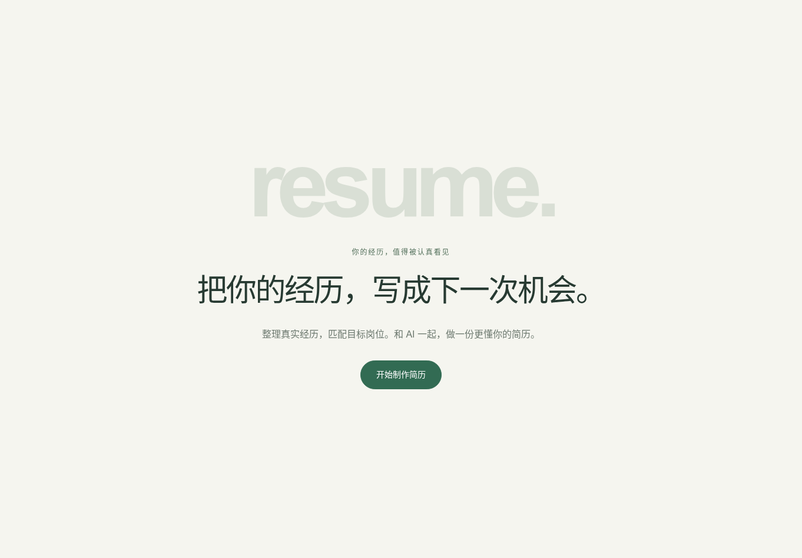
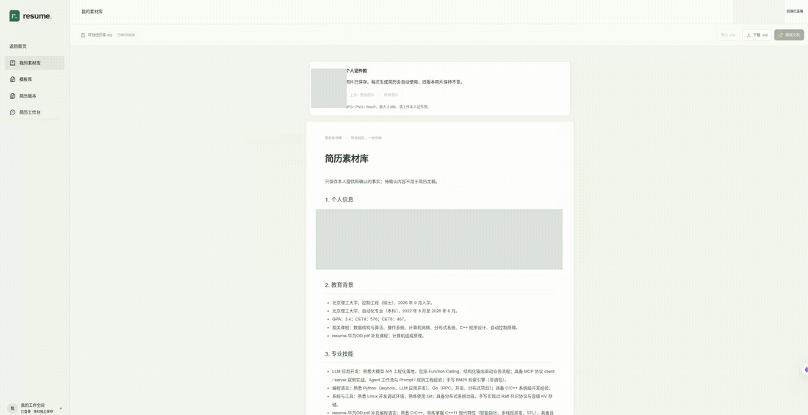

<h1 align="center">Resume Workflow</h1>

<b>把你的经历，写成下一次机会。</b>

整理真实经历，匹配目标岗位。和 AI 一起，做一份更懂你的简历。

  <a href="https://resumeworkflow.com/"><b>访问官网</b></a> ·
  <a href="https://resumeworkflow.com/#workspace">开始制作简历</a> ·
  <a href="https://resumeworkflow.com/#templates">浏览模板</a>

## 看看怎么用

保存经历 → 选择模板 → 提供岗位要求 → 查看处理进度 → 预览简历。

  

<a href="https://resumeworkflow.com/#workspace"><b>进入工作台，制作你的简历 →</b></a>

## 为每一次申请，准备合适的简历

经历散落在旧简历、项目记录和聊天里，换一个岗位，又要重新整理、取舍和排版。

**Resume Workflow 是一个在线简历工作空间。** 你可以把经历集中保存，选择喜欢的模板，再把目标岗位发给 AI，围绕真实的个人经历制作简历。生成后，继续修改正文、预览效果，并下载 PDF。

适合正在准备实习、校园招聘或下一份工作，希望持续积累经历、为不同岗位准备不同简历的你。打开浏览器即可使用，不需要安装软件，也不需要懂代码或 LaTeX。

## 你可以用它做什么

### 把经历留下来，下次不用从头讲

在「我的素材库」保存教育背景、实习、项目和技能。可以上传已有简历，让 AI 帮你整理，也可以通过对话补充细节，或直接编辑素材文档。

- 已保存的素材可在多次对话和后续制作中重复使用。
- 素材编辑自动保存，支持本次编辑过程中的撤销与重做。
- 支持导入、下载 Markdown 文档，方便保留自己的经历副本。
- 可以上传个人证件照，用于后续简历制作。

### 围绕目标岗位，组织自己的优势

把岗位描述（JD）和制作要求发到「简历工作台」。AI 会结合素材中的经历，组织相关内容、调整表达重点，并使用你选定的模板制作简历。

你可以说明希望突出什么，例如：

> 这是我准备申请的 AI 应用开发实习岗位。请使用当前选中的中文模板，突出我的项目实现和实习成果，制作一页简历。

制作过程中可以逐步看到助手回复，以及读取模板、编译和检查等处理进度。生成流程以一页简历为目标，并检查排版；资料不清楚时需要补充确认，下载后也请核对个人信息和表述。

### 选择版式，也能创建自己的模板

模板库提供中英文系统模板，可以先预览，再选择使用。你也可以上传 PDF 或图片作为版式参考，转换成自己的可复用模板。

参考模板中的姓名和经历不会作为你的个人素材。转换效果可能与原稿有差异，请先检查预览，再用于制作。

### 生成后，仍然可以自己修改

在「简历版本」预览 PDF，点击「编辑正文」即可调整已有文字、修改日期或加粗重点，再生成并保存新版本，原版本会保留。

正文编辑目前主要用于调整已有段落；复杂模板的编辑支持程度可能不同。需要交付时，直接下载 PDF 即可。

### 为不同岗位，保留不同版本

生成的简历会保存在自己的账号下，方便随时查看、下载和管理。在其他设备登录同一账号，也可以访问已经保存的素材和简历。

更新素材后，后续制作可以使用新内容；已经保存的简历不会被自动改写。

## 先看看模板

两套系统模板分别适合中文和英文简历。以下是版式示例，实际制作会使用你自己的信息和经历。

<table align="center">
  <tr>
    <td align="center" valign="top" width="50%">
      <b>中文模板</b>  
      
    </td>
    <td align="center" valign="top" width="50%">
      <b>英文模板</b>  
      
    </td>
  </tr>
</table>

<a href="https://resumeworkflow.com/#templates">前往模板库，选择你的版式 →</a>

## 怎么开始使用

打开 **[resumeworkflow.com](https://resumeworkflow.com/)**，点击「开始制作简历」。可以先浏览页面和系统模板，保存个人资料或发送消息时按提示登录。

### 1. 整理你的经历

在工作台上传已有简历，或直接描述自己的学习、工作和项目经历。例如：

> 这是我的旧简历，请先把其中的个人信息和经历整理到素材库，遇到不清楚的地方再问我。

然后到「我的素材库」查看、补充或纠正内容。如需在简历上使用照片，在这里上传本人的证件照。

### 2. 选择模板，提供目标岗位

进入「模板库」，预览并选定一个模板。返回工作台，粘贴岗位描述，补充语言、重点经历等要求，让 AI 开始制作。

### 3. 检查结果，下载 PDF

制作完成后，到「简历版本」查看排版和正文。需要小改时，可以直接编辑正文并保存新版本；确认后下载 PDF，用于投递。

**下次申请其他岗位时，继续使用已有素材，提供新的岗位要求即可。**

## 常见问题

**还没有写好的简历，能用吗？**

可以。直接描述你做过的实习、项目和具体工作，让 AI 帮你整理。尽量说明个人负责的内容、使用的方法和实际结果；不确定的信息先确认。

**可以上传什么文件？**

工作台支持 PDF、DOCX、PNG、JPG、WebP、TXT 和 Markdown。每条消息最多 3 个附件，每份最大 15 MB，单个 PDF 最多 10 页。模板上传支持 PDF 和图片；个人证件照支持 JPG、PNG、WebP，最大 5 MB。

**需要会排版吗？**

不需要。选择模板后，网站会处理简历排版和 PDF 生成。生成后可以预览，也可以通过正文编辑微调文字。

**能导出 Word 吗？**

目前提供 PDF 下载，暂不支持 Word 导出。

**资料保存在哪里？**

在线服务会在服务器保存账号下的素材、附件、对话和简历版本。AI 处理任务时，会将相关文字和图片发送给所使用的模型服务。你可以下载素材文档和生成的 PDF，也可以在版本页删除不需要的简历版本；删除版本不会删除素材库和原始附件。

**怎样反馈使用问题？**

欢迎在本仓库提交 Issue，描述遇到的问题或希望增加的功能。截图请遮住姓名、联系方式及其他个人信息。

---

<b>你的经历，值得被认真看见。</b>

<a href="https://resumeworkflow.com/"><b>打开 Resume Workflow，开始制作你的简历 →</b></a>

项目采用 <a href="LICENSE">MIT License</a> · Copyright © 2026 Zhihan Li

