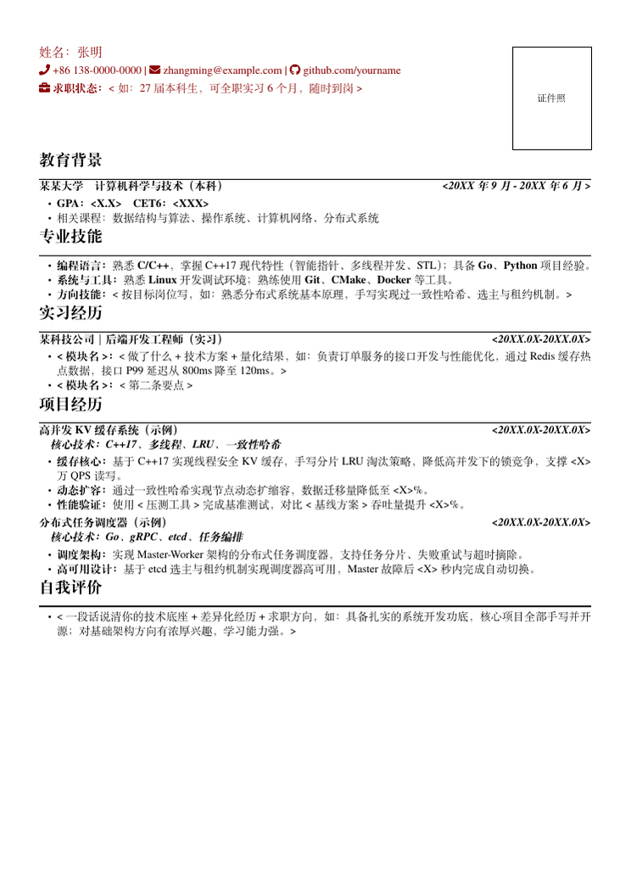
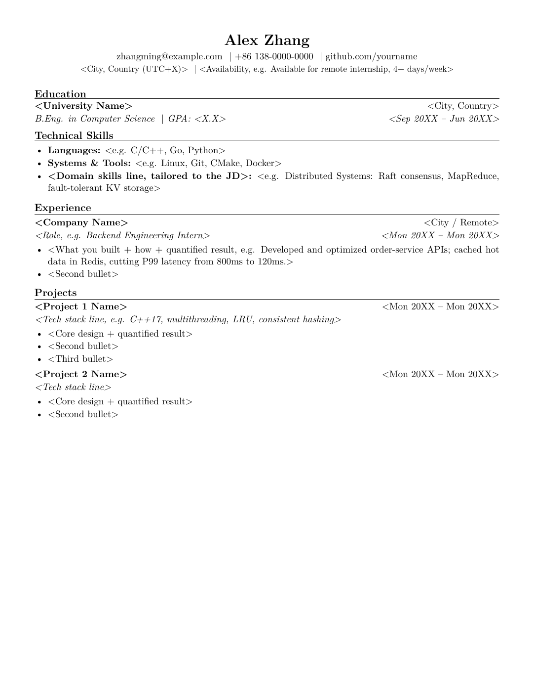

<h1 align="center">resume-workflow</h1>

<p align="center"><b>扔进去一个 JD，交付一份恰好一页的 PDF。</b></p>

<p align="center">不是"生成一份简历"，而是你的经历有一个唯一信息源，AI 帮你挖经历、挑素材、套模板、编译出片。</p>

<p align="center">
  
  
  
</p>

---

## 本地 Agent 与网站后端

已将命令行 Agent 拆分为可复用核心、本地工具模块、用户与会话存储、后台任务和 HTTP API。每位用户拥有独立的长期素材库，多次会话共享素材，生成版本独立保存。

- [架构设计](docs/架构设计.md)：模块职责、运行位置、用户存储与接口。
- [本地运行](docs/本地运行.md)：依赖、配置、终端与 API 启动、请求示例和测试。

已提供公开首页，以及素材文档、模板库、简历版本、对话工作台、账号管理五个页面。访客可以先浏览首页、工作台和系统模板，发送、上传或编辑时才弹出登录窗口，登录前输入的消息会保留。模板库支持系统模板和上传 PDF/图片转换的个人 LaTeX 模板，预览后选择用于后续生成。PDF / DOCX 提取文本后自动调用已配置模型整理到用户素材库，聊天和 PDF 预览下载均连接后端。用 `.venv/bin/python -m uvicorn backend.api:app --host 127.0.0.1 --port 8765` 启动后访问 <http://127.0.0.1:8765>，详见 [网页使用说明](frontend/README.md)。支持开放注册、密码登录、管理员管理及旧资料绑定；登录窗提供手机登录、邮箱登录、注册账号三个入口，登录窗提供手机、邮箱、注册三个入口，注册可设置用户名并验证手机或邮箱。默认手机验证码登录，首次验证通过自动创建账号；旧账号可在 `/password-login.html` 使用用户名或邮箱加密码登录并绑定手机号，忘记密码由管理员协助重置，详见[本地运行](docs/本地运行.md)。下面原有工作流介绍的是直接使用 AI 编程助手操作仓库的方式。

## 怎么用（就三步）

**第 1 步：把你的经历填进 `项目经历库.md`（只填一次）**

把所有项目、实习、技能写进这个文件——它成了你经历的唯一信息源。写不具体没关系，AI 会追着问你："这个数字有依据吗？这个项目的技术栈是什么？"帮你把每条经历打磨成能上简历的成品要点。以后有任何新经历，永远只更新这一个文件。

**第 2 步：把你喜欢的简历模板丢进 `模板/` 文件夹**

看到任何喜欢的简历样式——别人的 PDF、Word、截图——直接放进去。AI 会把它复刻成 LaTeX 排版模板。文件夹里自带两套现成的（中文版式 + 英文版式），可以直接用。

**第 3 步：投岗位时，把 JD 扔给 AI**

对你的 AI 编程助手（Kimi Code / Claude Code / Cursor 等）说一句：

> "这是我要投的 JD：<粘贴 JD>，用中文版模板做一版简历"

AI 会自动完成：分析 JD 要求 → 从素材库挑选最匹配的项目组合和排序 → 套进模板 → 编译出 `resume-<公司名>.pdf`。每投一个岗位一个文件，互不污染，Git 可 diff 可回滚。

---

## 两套自带模板

选完只是起点，之后每个细节都还能聊。

<table align="center">
  <tr>
    <td align="center"><b>中文 · 黑色页眉</b><br></td>
    <td align="center"><b>英文 · 美式极简</b><br></td>
  </tr>
</table>

每套模板 `.tex` 给 AI 读（学版式），`.pdf` 给你看（挑效果）。看到别人的简历更好看？丢进 `模板/`，它就是第三套。

---


## 它凭什么不一样

### 🎨 看到好看的简历，直接"偷"过来

别人的 PDF、Word、截图——任何你觉得好看的简历，丢进 `模板/` 文件夹，AI 会反解它的版式（字体、间距、章节线、日期对齐方式），复刻成一套 LaTeX 模板。审美不用自己攒，看见即所得。

### 📐 LaTeX 排版：工整，对 AI 友好，而且美

简历应该像名片一样漂亮。LaTeX 给你印刷级的工整——字体、字号、间距、对齐全部精确到 pt，和"Word 默认排版"一眼分出高下。同时它是纯文本：Git 可 diff、可回滚，样式宏写死在模板里，AI 只填内容不动宏，犯错空间压到最小。对 AI 最友好的格式，恰好也是最美观的格式。

### ⚡ 把 JD 丢给 AI，直接出排版好的 PDF

不需要会 LaTeX，不需要懂排版。一句"这是我要投的 JD"，AI 自动完成全流程：分析岗位要求 → 从素材库挑最匹配的项目组合 → 套进你选的模板 → 编译出 `resume-<公司名>.pdf`。每投一个岗位一个文件，互不污染。

### 📚 唯一项目库：聊一次，永久保存

你只需要跟 AI 聊聊你做过什么项目、什么实习——它会追着你问数字、问技术栈，把口述打磨成成品要点，存进 `项目经历库.md`。这就是唯一信息源：改经历只改这一处，之后生成的每一版简历都自动同步，十版简历永远一致。


## 快速开始

不需要任何手动操作，两步：

1. **Fork / clone 本仓库**
2. **用你的 AI 编程助手打开这个目录，对它说："帮我生成一版简历"**

剩下的 AI 全包：读 `AGENTS.md` 了解规则 → 引导你填素材库 → 问你要投的 JD → 挑内容、套模板、编译、把 PDF 交给你。LaTeX 环境缺什么它也会提示你装（或者用 Overleaf，本地环境都不用装）。

---


---

## 为什么是 LaTeX

简历应该像名片一样漂亮。LaTeX 是能给你这种"印刷级"质感的工具：

- **工整**：字体、字号、间距、对齐全部精确到 pt，通栏横线、右侧日期、斜体技术行，每个细节都听使唤——Word 里对齐一个日期能点十分钟鼠标
- **好看**：Times 系衬线字体 + 均匀的字距行距，印出来就是出版物水准，和"Word 默认排版"一眼就能分出高下
- **可控**：「恰好一页」靠的就是间距参数的微调，这在图形界面里几乎做不到
- **纯文本 = Git 可 diff**：为某个岗位改了什么一目了然，可回滚、可 review；样式宏写死在模板里，AI 只填内容不动宏，犯错空间压到最小

而且你不需要会 LaTeX——写经历用 Markdown，排版和编译全是 AI 干。不用 LaTeX 也没关系：素材库 + AGENTS.md 的工作流是格式无关的，模板层可以换成 Typst 或 HTML。

---

## 里面装了什么

```text
├── backend/               # Python 后端：Agent、工具、账号、任务与存储
├── frontend/              # HTML、CSS、JavaScript 与网页静态资源
├── 模板/                  # 中英文系统 LaTeX 模板和 PDF 预览
├── docs/                  # 架构、运行说明与预览图
├── deploy/                # 镜像发布、验证、代理与备份工具
├── tests/                 # 自动化测试
├── data/                  # SQLite、个人素材、照片、模板及生成简历（私有）
├── dist/                  # 本地生成的服务器部署配置包
├── api.py / agent.py / account_admin.py / task_metrics.py # 原命令兼容入口
├── Dockerfile / compose.yaml / compose.ssh.yaml / compose.ip.yaml / compose.ip-https.yaml / compose.existing-proxy.yaml / .dockerignore
├── requirements.txt / requirements-sms.txt / .env.example
├── AGENTS.md              # Agent 工作规则与系统提示词来源
└── README.md / LICENSE
```

网页及终端用户的素材库位于 `data/users/<user_id>/workspace/项目经历库.md`；根目录不存放共用的个人经历。`.env`、`.venv/`、`data/` 和 `dist/` 均保留在本机，不提交 Git。旧启动命令继续可用，新代码统一从 `backend` 包导入。完整目录职责见[架构设计](docs/架构设计.md)。

---

## 常见问题

**没有 AI 助手能用吗？**
能，就是慢点。素材库 + 模板的手工工作流照样成立。

**我的真实简历要上传吗？**
不要。这个仓库只放模板和示例。真实经历、电话、证件照留在本地私有目录。

---

## 一起把它做得更好

特别欢迎这三类分享：

- 你**真实在用**的简历模板
- 你写简历总结出的经验
- 你对「什么是好简历」的认知

提 Issue、发 PR，或者告诉我你的想法。

---

<p align="center"><b>如果它帮到了你，给个 ⭐️ 是对开源最大的鼓励。</b></p>

---

MIT License

Copyright (c) 2026 Zhihan Li


服务器采用本地构建镜像、测试后发布、服务器拉取运行的方式。SQLite 和用户文件独立保存在服务器持久目录，不打入镜像，更新时复用原目录。入口为 `deploy/release.sh` 和 `compose.yaml`，迁移、备份、升级步骤见[本地运行文档](docs/本地运行.md#镜像构建与服务器部署)。当前容器打包尚不包含每次编译的独立沙箱，公开处理任意用户模板前仍需补齐该隔离。
