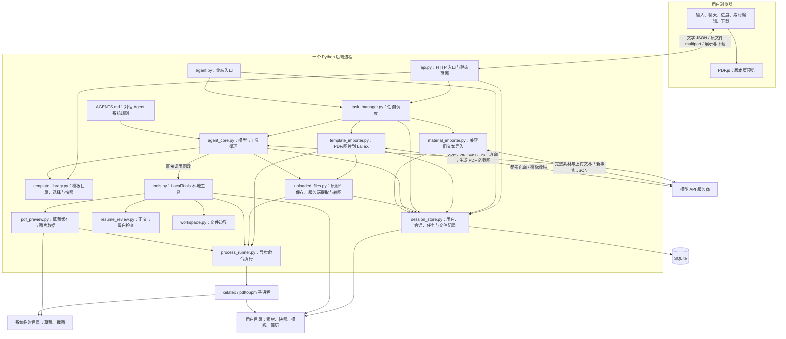

# Resume Agent 后端架构

更新日期：2026-10-04

本文按当前代码描述已实现的架构。后端 Agent 通过 `tools.py` 直接调用本地 Python 工具，已移除 MCP client/server 通信。一个工具模块提供读、创建、局部修改、编译、预览五项模型能力。

网页提供登录和账号管理，简历业务页面只负责输入、原文件上传、文档编辑、模板选择与结果展示。后端保存原始附件并处理 PDF / DOCX，图片和 PDF 页面作为实际图片传给模型，与用户文字一起理解。Word 导出、原生 PDF 文件输入接口和对外 MCP 服务尚未实现。

启动步骤见 [本地运行](本地运行.md)，网页说明见 [prototype/README.md](../prototype/README.md)。

## 1. 目标与范围

同一套 Agent 核心服务于终端和网页。用户拥有一份长期素材库，多次会话共同引用它；会话历史独立，生成文件按任务保存为不同版本。

第一阶段由一个 Python 后端进程管理任务，编译和截图时按需启动外部命令子进程。浏览器通过 HTTP 访问 API；终端直接调用相同的任务管理与 Agent 核心。模型运行在模型 API 服务商处，Python 程序、文件存储和 LaTeX 编译运行在本地电脑，之后可部署到服务器。

## 2. 架构图



网页代码运行在浏览器，Python 模块运行在本地电脑或部署后的服务器。模型通过网络 API 调用；`tools.py` 与 Agent 在同一 Python 进程内，通过函数调用传递参数与结果。`xelatex` 和 `pdftoppm` 是编译、截图程序，不是 MCP 服务。

模型密钥保存在后端 `.env` 或环境变量中，不发送给浏览器或编译、截图子进程。代码分成多个文件用于划分职责，不要求分别部署。

## 3. 模块职责

| 模块 | 职责 |
| --- | --- |
| `agent.py` | 终端输入输出、本地用户凭据与最近会话恢复 |
| `api.py` | HTTP 请求校验、凭据验证、会话与任务查询、文件下载 |
| `agent_core.py` | 每次模型请求注入最新完整素材库和会话上下文，执行模型→工具→模型循环，提交完整结果 |
| `tools.py` | 向模型提供工具定义，校验调用参数，直接执行文件读写、PDF 编译和预览；每个任务持有独立目录 |
| `account_api.py` / `account_store.py` | 账号路由、Cookie/CSRF、密码哈希、旧资料绑定、可撤销会话与限流 |
| `sms_gateway.py` / `account_admin.py` | 可选短信适配器、服务器终端授权管理员及密码恢复 |
| `session_store.py` | SQLite 持久化、用户目录、归属检查、运行锁和重启恢复 |
| `task_manager.py` | 后台执行、并发上限、超时、执行事件与失败状态 |
| `material_importer.py` | 兼容旧 `/imports` 文本导入接口，网页新上传不走此流程 |
| `template_library.py` | 动态发现系统模板；隔离个人模板、选中状态、模板预览与任务快照 |
| `template_importer.py` | 参考 PDF/图片转 LaTeX；编译修复、单页预览与模型截图检查，不读取或改写个人素材 |
| `uploaded_files.py` | 保存原文件；隔离进程读取 PDF/DOCX、转图片；恢复历史附件的多模态输入 |
| `workspace.py` | 文件路径解析与读写边界检查 |
| `process_runner.py` | 异步执行编译与截图命令，限制环境变量，超时或取消时终止并回收子进程 |
| `pdf_preview.py` | 缓存编译草稿与哈希元数据，渲染整页图片，提供 `PreviewResult` 与预览有效性校验 |
| `resume_review.py` | 成果加粗、项目要点和页底留白的有限检查 |

对话与生成 Agent 的系统提示词维护在根目录 `AGENTS.md`，`agent_core.py` 在每次 `run_turn` 开始时读取一次；同一任务后续模型调用复用这些规则。最新完整素材则在每次模型调用前重新读取并注入。工作台附件进入 `AgentCore`；旧 `/imports` 兼容接口仍使用 `material_importer.py` 的结构化提取流程。

保留现有模型工具循环，不引入新的 Agent 编排框架。模型工具包含文件读取、文件写入、局部代码修改、PDF 编译和 PDF 截图预览；不建立素材索引，不做分块或 top-k 筛选。每次模型调用前读取该用户最新 `项目经历库.md` 全文，并作为事实数据加入当次请求；刚被工具修改的内容立即可见，全文副本不反复写入会话历史。上传整理同样提供完整现有素材和上传文本。

素材较大时，全文输入会增加 token 用量并受模型上下文窗口限制。当前按小素材库设计，不自动截断或切换其他取材模式。

## 4. 长期存储设计

模板库通过 `GET /templates` 列出系统/个人模板，`PUT /templates/selection` 保存当前用户选择，`POST /sessions/{session_id}/templates` 上传并创建 `kind=template` 任务，`GET /templates/{template_id}/files/{kind}` 鉴权下载 tex/pdf/png/original。选择尚未转换成功的模板返回 409，访问其他用户模板返回 404。转换与普通生成共用排队、超时、监控和失败重试。

`custom_templates` 关联用户、任务与上传原稿；`template_selection` 保存每个用户的选择。系统模板从根目录 `模板/*.tex` 动态发现，可选同名 PDF 预览及 JSON 名称/简介。个人模板位于用户目录 `模板/custom/<task_id>/`，保存 template.tex/pdf/png 和 notes.txt。转换要求模板示例单页并通过模型截图检查，不应用正式简历的内容/留白验收；正式生成仍须通过原有验收。转换源码由模型重建，不能保证与原 PDF 完全一致。

模板初稿使用 `latex` JSON；已有源码的修复使用 `base_sha256` 和 `edits[{old,new}]`，拒绝完整源码响应。所有编辑针对同一基线进行唯一匹配与重叠检测，通过完整性校验后一次性应用；失败保留当前文件，将原问题及补丁错误一起反馈。修复请求只包含当前源码、版本和反馈，不累积旧源码/旧补丁；视觉检查仍携带参考附件、最新组装的源码及新截图。任务事件 `template_patching`、`template_patch_applied`、`template_patch_rejected` 记录进度，应用事件只保存哈希、编辑数量和字符数，不记录源码。

对话任务在 payload 中固定 template_id，开始时复制到用户目录 `模板/tasks/<task_id>.tex`，并将 `selected_template` 名称和路径传给 Agent。模型从该路径读取模板，按照 `AGENTS.md` 用个人事实替换示例，后续切换选择不会影响已提交任务。转换模型仅接收参考附件和转换规则，不接收个人素材或对话历史；生成物不写入简历版本表。

数据库记录用户身份、会话、完整模型历史、任务状态、执行事件、文件归属和相对路径。文件系统保存实际素材和生成文件。两者一起组成完整的用户数据。

```text
项目目录/
├── agent.py / agent_core.py / tools.py
├── api.py / task_manager.py / session_store.py / workspace.py
├── account_api.py / account_store.py / account_admin.py / sms_gateway.py
├── process_runner.py / resume_review.py / pdf_preview.py
├── AGENTS.md
├── 模板/                          # 公共模板
├── requirements.txt / requirements-sms.txt / .env.example
├── docs/
├── tests/
└── data/                          # 不提交 Git，可配置其他持久目录
    ├── resume.sqlite3             # 用户、会话、任务、文件记录
    ├── auth-secret                # 验证码 HMAC 校验密钥，随数据备份
    ├── runtime.lock               # 单进程运行锁
    ├── cli-profile.json           # 终端用户凭据及最近会话
    └── users/
        └── <user_id>/
            └── workspace/
                ├── 项目经历库.md  # 该用户唯一事实来源
                ├── 模板/         # 公共模板副本、custom/ 个人模板、tasks/ 任务模板快照，工具只读
                ├── snapshots/    # 每轮处理前后的素材快照
                └── resumes/
                    └── <task_id>/ # 本次生成的 .tex 和 .pdf
```

新用户初始化空白素材结构，不导入仓库示例人物和个人经历。已有个人素材需明确选择后导入目标用户目录；原文件不会自动移动或覆盖。

不同用户有独立素材、模板副本、历史和输出文件。同一用户的多个会话共享一份素材，但历史独立。素材更新不会改写已生成文件，快照保留本轮处理前后的事实依据。

会话历史只在完整一轮成功后提交，避免持久历史中出现没有工具结果的工具调用。失败请求、错误和执行事件保存在任务记录中。对话 Agent 通过工具完成的素材写入不会因后续模型失败而自动回滚；上传整理在 `complete_import` 提交异常时会尝试恢复提交前的素材。

数据库保存模型历史中的文字和工具调用结果，不保存临时注入的完整素材副本或截图 Base64。任务的 `payload` 保存导入文本以便失败重试；成功入库时还保存 `snapshots/<task_id>-source.json` 和素材前后快照。预览草稿、哈希元数据和渲染 PNG 位于系统临时目录，不属于长期版本。

长期保存依赖持久目录。迁移时同时迁移数据库和用户文件，备份时停止写入再备份整个数据目录。未来可把 SQLite 替换为服务端数据库，把文件系统替换为对象存储；后端接口仍通过文件编号访问。

## 5. 身份与访问边界

账号开放自行注册，密码使用 Argon2id 哈希。`account_store.py` 在原 SQLite 中新增账号、登录会话、限流和验证码表；用户编号仍关联原素材、会话、模板和文件。注册时持有有效旧凭据可绑定原工作空间，事务内撤销旧凭据，避免另建空账号导致原资料不可见。

网页使用 7 天有效的 HttpOnly / SameSite=Lax Cookie 登录，数据库保存凭据摘要；HTTPS 或显式配置时启用 Secure。写请求校验来源、客户端标识和登录会话 CSRF。`X-Resume-Account` 检查标签页预期账号，避免切换账号后旧页面继续操作新账号。各资源仍进行用户归属检查。密码变更和停用账号撤销旧会话。浏览器只存用户编号、会话位置及本地草稿，不存新登录凭据。

手机号支持 +86 的验证注册、验证码登录、绑定和重设密码。`sms_gateway.py` 通过可选的阿里云 SDK 发送；未配置时明确返回 503。验证码仅保存带服务端密钥的摘要，5 分钟过期、单次使用、用途隔离、最多 5 次校验失败；发送按手机号、IP 和全站限流，认证操作另有限流。密码哈希放到有并发上限的线程池，避免阻塞模型任务的异步事件循环。

普通用户不能访问管理员接口；管理员可查看账号、停用/恢复账号和重设密码。管理员授权仅通过服务器 `account_admin.py promote` 命令完成；不自动提升首个注册用户，不允许停用自己或最后一个启用的管理员。服务配置与恢复操作见《本地运行》。公开部署仍需配置 HTTPS、短信服务，并依据实际负载完善配额和运行隔离。

旧 `POST /users` 和 Bearer HTTP 认证默认关闭，只供隔离测试显式开启；终端本地凭据保留供 CLI 使用。

浏览器不能指定实际磁盘路径。下载使用后端登记的文件编号，经归属校验后读取对应文件。

## 6. 本地工具与编译边界

每轮任务创建自己的 `LocalTools` 实例，显式传入用户工作目录和本次输出目录，并创建独立的临时预览目录。模型工具描述通过请求的 `tools` 参数提供，模型返回工具名和参数后，后端校验并直接调用 Python 函数。保留 `resume__` 工具名前缀以兼容已有会话，它不再代表 MCP 通信。没有 MCP 客户端、工具服务进程或运行时工具发现；不使用全局目录环境变量或 `chdir()`。

LaTeX 和截图程序仍作为必要的外部命令运行，通过异步子进程避免阻塞其他用户任务。命令只继承运行所需环境变量，不继承模型密钥；超时或取消后先终止并回收命令，再清理临时文件。

模型可见工具与本地方法如下。工具定义由方法说明和参数签名构建，调用分发只接受已登记工具，要求参数齐全、均为字符串且无多余字段。

| 模型可见工具名 | 本地方法与参数 | 返回内容 |
| --- | --- | --- |
| `resume__read_file` | `read_file(path)` | 素材为 UTF-8 文本；`.tex` 为含 content、base_sha256 的 JSON |
| `resume__write_file` | `write_file(path, content)` | 保存素材、创建初稿或写回修改后的完整 `.tex` |
| `resume__edit_file` | `edit_file(path, base_sha256, edits_json)` | 原子应用局部替换，返回新版本；使旧 PDF 和截图失效 |
| `resume__compile_pdf` | `compile_pdf(tex_file, layout_json="")` | 编译与质量检查结果文字 |
| `resume__preview_pdf` | `preview_pdf(tex_file)` | `PreviewResult`：图片、哈希、页数等元数据 |

模型返回工具调用请求后，`AgentCore` 解析参数，交给 `LocalTools.call()` 执行，再把结果作为工具消息传回模型。未知工具或无效参数返回参数错误；预期的文件和操作错误返回工具错误文字。编译失败通常作为工具结果返回，模型可以继续修正，任务不因此立即失败。

简历初稿用 `write_file` 创建；已有 `.tex` 小改优先使用 `edit_file`，大改也可用 `write_file` 写回完整源码，由模型自行选择。两种方式都在当前版本基础上修改；行距/下边距仍用 `compile_pdf` 参数微调。与模板转换共用 `tex_edits.py` 的版本、唯一匹配及区域重叠校验；失败不改源码、PDF 或截图，成功后原子保存并废弃旧 PDF 和截图。`AgentCore` 对局部修改同样执行“先查看刚编译截图”和最多六轮截图的限制，修改后须重新编译验收。

文件工具只允许读取当前素材、模板和本轮文件，只允许写入素材库与本轮 .tex。绝对路径、父目录跳转、越界符号链接、模板写入被拒绝。通过每次模型调用重读全文获取最新素材。工具暂不能读取其他任务目录中的历史简历，尚无“指定旧版本作为修改基础”的文件入口。

编译使用独立任务目录，禁用 shell escape，启用 TeX 读写限制；两次编译均检查退出码，每次编译限制 120 秒。旧 PDF 在开始前删除，失败时删除不合格输出；生成结果须恰好一页。编译中间文件在成功和失败后清理。编译后还对正文中素材已有的量化成果检查加粗，并结合 PDF 文字基线估算页底留白；所有模板统一以用户提供的 `resume-Agent开发.pdf` 为基准，页底留白目标 3.62%，上限 4.00%（A4 约 10.76 mm / 11.88 mm）。留白比例为最后文字基线距纸底除以纸高，包含正常页边距；超过上限即独立判定不合格，不再依赖项目标题或条目是否识别成功。对可识别的中文项目同时提示独立贡献过度合并；没有可测文字时按未通过处理。未通过时删除未验收 PDF，返回具体原因供模型修改正文再编译。检查是模板范围内的启发式检查，不等同于完整的事实或视觉审校。

每次编译有可读 PDF 时，在任务临时目录缓存草稿，供 `preview_pdf` 使用 `pdftoppm` 转成最长边 1800 像素的整页 PNG，最多展示前 3 页（仍报告实际页数）。预览元数据的 `layout_checks` 返回每页留白毫米数、比例、目标、上限及达标标记，与编译检查使用同一计算函数。失败草稿仅供检查，不注册到用户版本库；`LocalTools` 任务上下文退出时删除临时草稿与元数据，截图渲染文件用完即删。

Agent 自动在编译后请求预览。预览工具直接返回模型请求所需的 `image_url` 图片数据，在所有工具回复之后追加一条临时多模态消息；不把图片 Base64 写入持久聊天历史。含图片的模型请求成功返回后，内存中记录该截图对应的正文、素材和 PDF 哈希；代码不额外解析模型是否给出独立的“视觉通过”结论。写入新正文会废弃旧 PDF 和缓存；交付时核对三个哈希，拒绝未经当前版本截图检查的 PDF。

单任务最多 6 轮截图，之后拒绝继续改稿与编译，要求模型说明剩余问题。整体仍受 20 次模型请求和 600 秒限制。视觉检查由模型判断，不是“必定满页”的保证；中转拒绝图片或预览失败时不能静默跳过检查交付 PDF。

这些措施不等同于完整的操作系统沙箱。公开处理不可信 LaTeX 前还需要受限编译容器、内存/CPU限制和文件系统隔离。

## 7. API

| 方法与路径 | 功能 |
| --- | --- |
| `GET /health` | 服务运行状态，不保证模型与编译依赖可用 |
| `POST /auth/register`、`POST /auth/login` | 自助注册、密码登录并设置登录 Cookie |
| `GET /auth/me`、`POST /auth/logout` | 当前账号、CSRF 与退出登录 |
| `GET /auth/config`、`POST /auth/sms/send`、`POST /auth/sms/login` | 短信可用性、验证码发送、手机注册/登录 |
| `PUT /auth/phone`、`PUT /auth/password`、`POST /auth/password/reset` | 绑定手机号、修改密码、短信重设密码 |
| `GET /admin/users`、`PATCH /admin/users/{uid}`、`PUT /admin/users/{uid}/password` | 管理员查看、停用/恢复和密码重置 |
| `GET /materials` | 读取当前用户 Markdown 和 revision |
| `PUT /materials` | 检查 revision、无活跃任务时保存素材，保留修改前快照 |
| `GET /versions` | 当前用户真实生成的 PDF 列表 |
| `DELETE /versions/{file_id}` | 删除本人已完成的指定 PDF 版本及同名 LaTeX 源文件，撤销对应下载记录 |
| `GET /tasks/active` | 当前用户正在执行的任务，供刷新恢复 |
| `GET /sessions` | 列出当前用户的会话 |
| `POST /sessions` | 创建会话 |
| `GET /sessions/{id}/messages` | 读取界面可展示的用户消息与助手回复 |
| `POST /sessions/{id}/messages` | JSON 文字或 multipart 文字+原始附件，返回 HTTP 202 与任务编号 |
| `POST /sessions/{id}/imports` | 兼容旧版已提取文本导入，网页不再调用 |
| `GET /sessions/{id}/uploads/{upload_id}` | 经用户及会话归属校验下载原附件 |
| `GET /sessions/{id}/tasks` | 会话最近任务与失败信息 |
| `POST /sessions/{id}/tasks/{task_id}/retry` | 使用持久化输入重试失败任务 |
| `GET /sessions/{id}/tasks/{task_id}` | 查询状态、事件、结果和生成文件编号 |
| `GET /sessions/{id}/files/{file_id}` | 下载有权访问的生成文件 |

纯文字请求为 `{"message":"..."}`；附件请求为 multipart，包含 `message` 及最多 3 个 `files`。允许只发送附件。完全空白、错误类型和超过 30000 字符的文字返回 400。缺少或错误凭据返回 401，无权访问的资源返回 404，当前用户已有未完成任务时返回 409。

第一阶段使用轮询查询任务状态，后续可增加事件推送。

版本删除只针对所选 PDF 及同任务、同路径的同名 `.tex`，不删除同任务下其他版本、素材库或上传附件。删除前验证用户归属、任务完成状态和文件路径；先临时移走文件，再删除数据库记录，数据库失败时恢复文件。网页确认后删除，自动切换到剩余版本；删除最后一份时清空预览与下载链接。聊天中的历史生成说明保留，已删除文件不再可下载。

前端由同一 Starlette 进程托管，仅暴露 `prototype/`。浏览器负责选择文件、发送文字、图片本地预览、显示回复和 PDF；没有 PDF/DOCX 文字提取或模型业务逻辑。素材文档编辑属于用户输入，保存仍校验 revision 与用户活跃任务锁。

`uploads` 表记录原文件的用户、会话、名称、大小与服务器生成的存储路径；文件位于用户工作目录 `uploads/<随机编号>/original.<扩展名>`。任务 payload 和聊天历史只保存附件编号，恢复或重试时从服务器原文件重新取得输入。前端不能指定磁盘路径，跨用户、跨会话下载均拒绝。

附件在独立进程内准备，PDF 用 pypdf 提取文字并用 pdftoppm 将所有页面转图，DOCX 提取段落、表格、页眉页脚及可转换内嵌图片，PNG/JPEG/WebP 做格式校验和尺寸归一化。扫描 PDF 也提供整页图片给模型，不依赖可复制文字；这是视觉模型阅读，不是独立 OCR 服务。预处理结果缓存在对应附件目录，图片 Base64 只在请求模型时构造，不持久写入对话。

单文件 15 MB，每条消息最多 3 份，单 PDF 最多 10 页；每条消息最多 12 张图片/页面、12 万字符，单文件最多 6 万字符，超限明确失败，不静默截断。旧 `.doc` 需转 DOCX，Word 部分不支持的矢量图形会提示核对。模型根据文字要求识别附件用途，用户本人简历自动整理入库；JD、参考模板和他人简历不冒充用户经历。直接工具写入遵循原有 Agent 流程，不再对网页附件采用旧 `/imports` 的文本指纹去重机制。

旧 `/imports` JSON 接口保留用于兼容已存在的文本导入任务与重试。其结构化校验、分节追加和指纹去重行为不变。

## 8. 任务生命周期

```text
queued → running → completed
                  └→ failed
```

对话事件包括 `attachment_processing`、`model_started`、`tool_started`、`tool_completed`、`preview_started`、`visual_review_started`；导入还包括 `import_started`、`materials_saving`、`materials_saved`。任务管理器正常结束时发送 `completed`，普通异常时发送 `failed`，不编造进度百分比。服务停止取消任务时直接写入失败状态，不保证发送 `failed` 事件。`tool_completed` 表示调用返回，具体业务成功与否由工具结果和最终回复解释。`completed` 也不保证有 PDF：补充素材或追问信息可能正常完成一轮对话；若本轮已尝试编译而最终没有合格 PDF，任务标记失败并保留最后编译原因，不能只凭模型的完成回复结束为成功；前端应以任务返回的 `files` 判断是否有可下载 PDF。

同一用户一次仅允许一个活跃任务，避免不同会话同时修改共享素材；不同用户最多同时执行三个任务。单轮默认最多 20 次模型迭代，整轮执行超时为 600 秒（不含等待并发槽位的时间）。

任务记录持久保存，执行本身位于单进程内。服务关闭会取消任务并写入失败状态；异常退出后，下次启动把遗留活跃任务标记为中断失败。运行锁防止两个终端/API进程同时使用同一数据目录，避免错误恢复和并发冲突。当前运行锁针对 Linux/macOS。

## 9. 两条业务流程与验收

### 9.1 上传简历并整理素材

1. 用户选择、粘贴或拖入附件，可同时输入说明，点击发送。前端以 multipart 提交文字和原文件。
2. API 验证归属和大小、保存原附件，为统一对话创建 `kind=chat` 任务。
3. 后端预处理附件，把文字和图片与原用户消息一起送给模型。
4. 模型按用户要求调用素材读写或简历生成工具；识别为用户自己的简历时主动整理已确认事实，用途不明确时询问。
5. 浏览器轮询任务，展示回复并刷新素材和简历版本。原附件可在历史中再次下载，失败可用原附件重试。

### 9.2 对话与生成简历

1. 网页提交消息或终端输入消息，创建 `kind=chat` 的后台任务。
2. `AgentCore` 创建任务输出目录和素材前快照，读取历史与 `AGENTS.md`，创建 `LocalTools`。
3. 每次模型请求带上最新完整素材、对话历史、五个工具定义以及当前有效的预览图片。
4. 模型自行决定读取模板、选择内容、写入 LaTeX、编译或提问；这些步骤不是独立的固定任务状态。
5. 编译调用后自动尝试截图，下一次模型请求查看实际版面，按需继续修改；受迭代和截图上限约束。
6. 模型不再请求工具时，校验待交付 PDF 与已发送预览的哈希一致，再保存历史、回复、文件记录及任务完成状态。
7. 网页从任务结果和版本接口获取文件编号，经鉴权下载 PDF；版本页目前仍由浏览器 PDF.js 渲染预览。

### 9.3 验证范围

已实现的测试覆盖：API 身份与归属检查、历史持久保存、文件下载、共享用户素材、用户并发限制、重启恢复、路径越界、任务超时、模拟模型配合真实本地工具的处理循环、素材全文刷新和真实 LaTeX 编译，以及素材编辑冲突、模型整理入库、重复导入、无效结果不写入和失败重试；本地工具迁移还覆盖并发用户文件与预览隔离、参数校验、子进程超时/取消回收和模型密钥不传入子进程。测试命令见运行文档。

本地工具迁移后已通过 26 项自动测试，覆盖模拟模型配合真实 LaTeX 与截图命令的链路。该结果不等于迁移后已重新进行付费模型在线联调；模型内容质量和视觉判断仍需实际简历验收。

## 10. 后续方向（尚未实现）

| 方向 | 当前边界 | 后续接入位置 |
| --- | --- | --- |
| 指定历史版本继续修改 | 每次工具只能读取本轮输出目录 | 增加版本选择与归属校验，将选中版本作为新任务的输入，记录版本关系 |
| Word 导出 | 当前仅生成 LaTeX / PDF，DOCX 只用于导入 | 单独实现 DOCX 生成与导出 |
| 对外提供简历 MCP 能力 | 当前没有 MCP 服务或外部 MCP 入口 | 在简历业务服务外增加适配层，按需暴露生成、修改、任务查询；内部继续直接调用本地工具 |

附件预处理已经由后台任务直接调用，无需额外模型工具。对外 MCP 是可选入口，不要求恢复内部 client/server 通信。

正式部署仍需根据实际需求补齐身份认证、配额、备份和受限编译环境。当前目录锁要求同一数据目录只有一个 Python 服务进程；API 与终端不能同时占用该目录。

### 留白基准验收

参考 `resume-Agent开发.pdf` 的 A4 页高约 297.00 mm，最后文字基线距纸底约 10.76 mm（3.62%）。统一 4.00% 上限提供约 1.12 mm 的 A4 排版容差；Letter 纸使用相同比例计算。常量定义在 `resume_review.py`，模型行为要求位于 `AGENTS.md`。这次仅保存测量值作为规则，不复制参考简历中的个人事实。

超过上限时失败草稿仍可截图，供模型补全内容后再编译；不能通过解释原因豁免。不够素材时说明缺口，保留未完成状态。此指标衡量页底空间，不覆盖内部大空洞、字体可读性或全页像素空白，仍需截图审查。已有版本不会自动重排，重启后端后新任务使用新检查。

## 任务性能观测

`task_metrics.py` 使用 ContextVar 为每个后台任务绑定事件写入器，用单调时钟记录 span 耗时，避免并发任务相互串线。覆盖排队、附件准备、每次模型调用、工具、xelatex/pdftoppm 等子进程、内容版面检查与结果保存；异常、取消和未闭合的中断 span 均保留状态。进程事件仅记录可执行文件名与返回码，不保存命令参数；新增指标不记录提示词、简历正文、模型响应正文、图片编码、密钥或异常响应体。原有业务事件保持兼容。

任务详情和最近任务列表在读取时生成 `performance`：运行中步骤显示累计等待，终止任务固定在结束时间；仅顶层 span 汇总到 `stage_ms`，内层步骤在时间线展示，不能再次相加。未埋点的历史任务返回明确标注的模型区间估算。请求接收计时在 API 层记录，浏览器另测发送到结果显示及 PDF 下载渲染，保持两个时钟边界独立。浏览器数据留在当前用户本机，服务端事件随任务持久保存。

当前没有流式首字时间、每次 SDK 重试的独立链路或中转服务内部时间，因此「模型耗时」表示一次 SDK 调用的完整等待，不能当作纯推理时间。没有改动模型、重试策略、简历生成或质量验收规则。查看入口与诊断命令见《本地运行》的任务耗时章节。

## 个人照片与生成依赖

`profile_assets.py` 管理用户明确上传的证件照：鉴权 API → 校验/标准化 → 用户工作区 `assets/photo.jpg`。素材库由文字事实和独立图片附件组成；照片不是模型自行推断或生成的内容。Agent 启动时将照片复制到任务目录，并在模型输入里提供 `profile_photo` 状态。模型通过既有写入、编译工具排版，无需新增图片生成工具。

本地编译工具检查 PDF 已绘制的图片与照片是否匹配，照片缺失于 PDF 时拒绝交付；`pdf_preview.py` 将照片哈希纳入预览一致性校验。运行中禁止更换个人照片，生成结果保留任务照片供源码复编、历史回溯使用。上传入口位于素材库页，所有照片读写按用户隔离，浏览器通过带鉴权的 fetch 获取预览。

生成服务启动时记录代码指纹，新任务发现磁盘 Python 文件变化会拒绝受理并提示重启，防止新提示词与旧验收代码混用。任务日志中的成功表示执行时的规则结果，不会反向更新旧 PDF。

## 模型主动测量与参数微调

`compile_pdf(tex_file, layout_json="")` 保持原有调用兼容，新增可选的 JSON 字符串参数。模型选择本轮 `line_spread`（1.00～1.15）和/或 `bottom_mm`（8～14 mm），后端在 document 前写入统一的参数覆盖区块，保留正文、照片和样式宏，执行一次编译验收。后端不自行搜索或决定参数；下一组由模型根据返回测量选择。未知键、非数字、越界值拒绝执行，缺少参数的旧调用照常编译。

工具返回页数、当前参数、页底毫米值/比例、完整验收问题、最近 6 次测量及下一步调整建议。`layout_checked` 事件持久记录每轮参数和结果，即使任务最终失败也能回看；事件不包含正文或图片。编译完必须先将截图交给模型，禁止在同一批调用中未经查看又修改版面。最多 6 轮截图（首次加 5 次修改复验），同时保留 20 次模型请求和 600 秒任务时限。交付继续执行一页、4% 留白、成果、照片及截图一致性检查。
